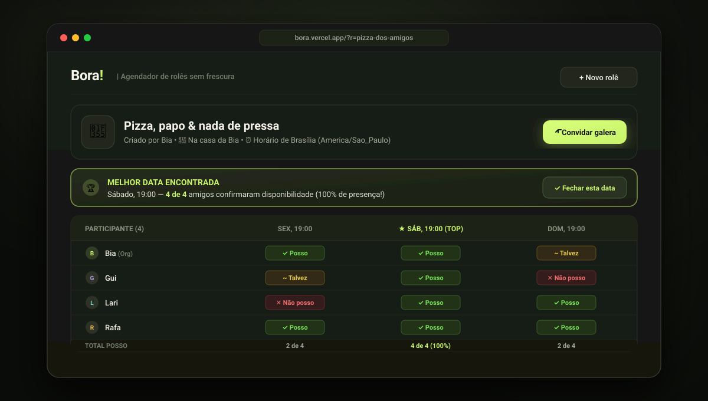

<p align="center">
  <br />
  <h1 align="center">⚡ Bora!</h1>
  <p align="center">
    <strong>Agendador de rolês moderno, minimalista e sem frescura.</strong><br />
    Encontre a data perfeita com seus amigos em segundos — sem cadastro, sem senhas e direto ao ponto.
  </p>
  <p align="center">
    
    
    
    
    
  </p>
</p>

<br />

<p align="center">
  
</p>

<br />

## 🎯 Sobre o Projeto

Marcar um encontro no grupo de amigos sempre vira um caos: dezenas de mensagens desencontradas, pessoas que só podem em dias específicos e ninguém querendo tomar a decisão final.

O **Bora!** foi criado para resolver esse problema com o mínimo de atrito possível. Quem organiza cria as opções de data e compartilha um link. Cada amigo abre no próprio celular ou computador, escolhe sua disponibilidade em segundos e o sistema calcula automaticamente a melhor data para todo mundo.

- **Zero burocracia:** Nada de login com Google, formulários intermináveis ou ter que baixar aplicativo.
- **Foco na experiência:** Interface escura refinada, detalhes em neon lima (_lime green_), animações fluidas e microinterações rápidas.

---

## ✨ Principais Funcionalidades

- **⚡ Zero Cadastro (Zero-friction):** Qualquer pessoa vota em menos de 10 segundos apenas digitando o próprio nome.
- **🗳️ Votação Rápida em 3 Estados:** Alterne com um clique entre **Posso** (🟢), **Talvez** (🟡) e **Não posso** (🔴).
- **📊 Heatmap Visual de Disponibilidade:** Uma matriz intuitiva que mostra claramente quem pode em cada data/horário proposto.
- **🏆 Cálculo Inteligente da Melhor Data:** O sistema analisa a pontuação de votos, resolve empates e destaca no topo a opção com maior quorum.
- **🔒 Painel de Organizador Sem Conta:** Quem cria o rolê recebe uma URL com segredo de administração seguro (via hash local), permitindo fechar o rolê quando quiser.
- **🎉 Fechamento Oficial & RSVP:** Ao fechar a data, a aplicação celebra com confetes e abre a lista de presença final (**Vou** / **Não vou**).
- **🔄 Sincronização em Tempo Real:** Atualização automática a cada 15 segundos para acompanhar os votos dos amigos ao vivo.
- **♿ Acessibilidade e Performance:** Totalmente responsivo, suporte nativo a leitores de tela, navegação por teclado e respeito a preferências de redução de movimento (`prefers-reduced-motion`).

---

## 🛠️ Tecnologias Utilizadas

Este projeto foi construído utilizando as melhores práticas do ecossistema moderno de JavaScript / TypeScript:

- **[Next.js 16](https://nextjs.org/)** — App Router, Serverless Functions e otimização com Turbopack.
- **[React 19](https://react.dev/)** — Componentização reativa e estado declarativo.
- **[TypeScript](https://www.typescriptlang.org/)** — Tipagem estática rigorosa para máxima segurança e manutenibilidade.
- **[Upstash Redis](https://upstash.com/)** — Armazenamento serverless de baixíssima latência via REST API (sem necessidade de conexões TCP persistentes ou pooling de banco pesado).
- **[Motion](https://motion.dev/)** — Transições suaves, gestos e animações baseadas em física.
- **[Lucide React](https://lucide.dev/)** — Conjunto de ícones leves e consistentes.
- **[Canvas Confetti](https://github.com/catdad/canvas-confetti)** — Efeito visual comemorativo leve e disparado sob demanda.
- **[Zod](https://zod.dev/)** — Validação estrita de schemas de dados e payloads de API.

---

## 🚀 Como Executar Localmente

### Pré-requisitos

- [Node.js](https://nodejs.org/) versão **22.0.0** ou superior
- Gerenciador de pacotes `npm`

### Passo a Passo

1. **Clone o repositório:**

   ```bash
   git clone https://github.com/seu-usuario/bora.git
   cd bora
   ```

2. **Instale as dependências:**

   ```bash
   npm install
   ```

3. **Configure as variáveis de ambiente:**
   Copie o arquivo de exemplo:

   ```bash
   cp .env.example .env.local
   ```

   _(No Windows PowerShell: `Copy-Item .env.example .env.local`)_

   > 💡 **Dica:** O projeto já vem pronto para funcionar em modo de memória local para testes. Para conectar com o banco real na nuvem, adicione suas credenciais do **Upstash Redis** no arquivo `.env.local`:
   >
   > ```env
   > UPSTASH_REDIS_REST_URL="https://seu-banco.upstash.io"
   > UPSTASH_REDIS_REST_TOKEN="seu-token-aqui"
   > ```

4. **Inicie o servidor de desenvolvimento:**

   ```bash
   npm run dev
   ```

   _(No Windows, se seu PowerShell bloquear scripts, execute: `npm.cmd run dev`)_

5. Abra [http://localhost:3000](http://localhost:3000) no seu navegador para ver o Bora! funcionando.

---

## 🌐 Deploy na Vercel

O Bora! foi arquitetado para rodar com excelência na **Vercel** usando Serverless Functions:

1. Faça o push do seu código para o seu repositório no GitHub.
2. Acesse a [Vercel](https://vercel.com/) e importe o repositório.
3. Nas configurações do projeto (**Settings > Environment Variables**), adicione:
   - `UPSTASH_REDIS_REST_URL`: URL REST do seu banco Upstash Redis.
   - `UPSTASH_REDIS_REST_TOKEN`: Token REST do seu banco Upstash Redis.
4. Clique em **Deploy** e seu agendador estará no ar! 🚀

---

## 🧠 Arquitetura e Segurança

- **Sem persistência invasiva:** Os dados do rolê possuem TTL de expiração automática de 180 dias.
- **Concorrência atômica:** Atualizações concorrentes de votos utilizam scripts Lua atômicos no Redis (`EVAL`), prevenindo condições de corrida quando múltiplos participantes votam simultaneamente.
- **Privacidade do organizador:** O segredo de administração nunca é enviado desnecessariamente ao cliente de outros convidados nem fica exposto no servidor.
- **Rate Limiting:** Proteção integrada contra abusos de requisições por IP.

---

## 📝 Licença

Este projeto está sob a licença [MIT](LICENSE). Sinta-se livre para usar, estudar e customizar!

<p align="center">
  Feito com 🍕 para acabar com a enrolação de marcar rolês.
</p>
