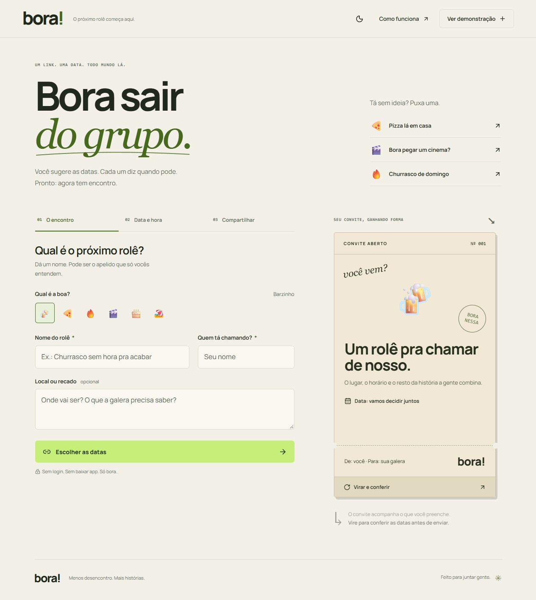
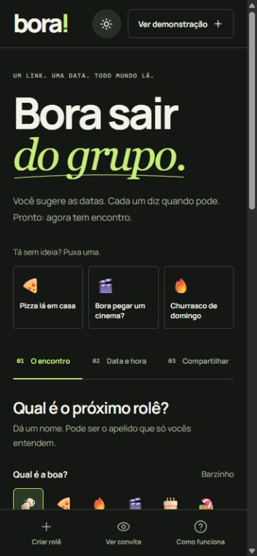

<div align="center">

<br />

# 🍾 bora!

**Do "vamos marcar" para "tô chegando" — sem 200 mensagens no meio.**

Encontre a data que combina com todo mundo, sem cadastro, sem senha e sem frescura.

[](https://borarole.vercel.app/)

<br />

[](https://nextjs.org/)
[](https://react.dev/)
[](https://www.typescriptlang.org/)
[](https://upstash.com/)
[](https://vercel.com/)
[](LICENSE)

</div>

---

## 📸 Preview

<div align="center">

### Criação do rolê



<br />



</div>

---

## 🎯 O que é isso?

Marcar um rolê com amigos virou um ritual de sofrimento: thread de grupo que nunca termina, cada um pode em um dia diferente, ninguém bate o martelo.

O **Bora!** foi feito pra resolver isso de vez.

1. **Você cria o rolê** — dá um nome, escolhe as datas possíveis e gera um link.
2. **Manda pra galera** — sem precisar criar conta, cada um abre o link e marca a disponibilidade em segundos.
3. **O app encontra a melhor data** — um heatmap inteligente mostra quem pode quando e destaca a data com mais presença.
4. **Fecha e acontece** — o organizador confirma a data oficial e todo mundo recebe a convocação final.

Zero burocracia. Zero mensagem perdida. Só o rolê.

---

## ✨ Funcionalidades

| Funcionalidade                | Detalhe                                                                   |
| ----------------------------- | ------------------------------------------------------------------------- |
| ⚡ **Zero cadastro**          | Acesse e vote só com seu nome — sem conta, sem senha, sem app             |
| 🗳️ **Votação em 3 estados**   | **Posso** · **Se for o jeito** · **Não posso** — clique e alterna         |
| 📊 **Heatmap visual**         | Veja de relance quem pode em cada data e qual tem maior quorum            |
| 🏆 **Melhor data automática** | Algoritmo de ranking resolve empates e destaca a data ideal               |
| 🔒 **Link de organizador**    | Controle administrativo por URL privada com hash — sem conta necessária   |
| 🎉 **Fechamento + RSVP**      | Feche a data oficial e colete confirmação de presença com confetes 🎊     |
| 🔄 **Sincronização ao vivo**  | Atualização automática a cada 15s — veja a galera responder em tempo real |
| 🌙 **Temas claro e escuro**       | Acompanha o sistema, com escolha manual persistida e acentos verde-lima                |
| ♿ **Acessibilidade**         | Foco visível, leitores de tela, teclado e `prefers-reduced-motion`        |
| 📱 **Responsivo**             | Funciona muito bem no celular, tablet e desktop                           |

---

## 🛠️ Stack Técnica

```
Next.js 16 (App Router + Serverless Functions)
├── React 19           → UI reativa, sem dependência de estado global
├── TypeScript         → Tipagem estrita end-to-end
├── Upstash Redis      → Banco serverless via REST API (sem TCP, sem pooling)
├── Motion             → Animações físicas (spring, ease, stagger)
├── Zod                → Validação de schemas na API
├── Lucide React       → Ícones SVG leves e consistentes
└── Canvas Confetti    → Celebração ao fechar a data (lazy loaded)
```

**Por que Upstash Redis?**
Funções serverless da Vercel não mantêm conexões persistentes entre invocações. O Upstash serve o Redis via HTTP REST, o que é perfeito para esse modelo: zero conexões pra gerenciar, latência mínima, TTL nativo pra expirar dados automaticamente.

---

## 🏗️ Arquitetura

```
app/
├── page.tsx            Orquestração: criação em etapas, votação, resultados e compartilhamento
├── components.tsx      Calendário, modal/painel arrastável com foco contido e toast
├── experience.tsx      Tema, navegação mobile, etapas, revelação e skeleton
├── invite-preview.tsx  Convite com frente/verso, datas e inclinação pelo mouse
├── interactions.tsx    Ideias prontas, seletor de vibe, contadores e votos animados
├── experience.css     Temas e composição responsiva mobile-first
├── globals.css         Tokens, componentes base e contrato de animações
├── layout.tsx          Metadados SEO, fonte local (Manrope), idioma
└── api/event/route.ts  API REST: GET / POST / PATCH com rate limit e validação

lib/
├── model.ts            Tipos, schemas Zod, algoritmo de ranking, transições de estado
└── store.ts            Camada de dados: Redis REST + memória local para dev
```

**Decisões técnicas relevantes:**

- **Concorrência atômica:** votos simultâneos usam scripts Lua (`EVAL`) no Redis — sem condições de corrida quando vários amigos votam ao mesmo tempo.
- **Privacidade real:** o segredo do organizador é armazenado apenas como hash no servidor e nunca trafega para outros clientes.
- **Dados com expiração:** rolês somem automaticamente após 180 dias — sem janitor jobs, sem cron.
- **Rate limiting por IP:** proteção contra abuso direto na API, usando `x-real-ip` do proxy Vercel.

---

## 🚀 Rodando Localmente

### Pré-requisitos

- [Node.js](https://nodejs.org/) **≥ 22.0.0**
- `npm`

### Passo a passo

```bash
# 1. Clone o repositório
git clone https://github.com/seu-usuario/bora.git
cd bora

# 2. Instale as dependências
npm install

# 3. Configure o ambiente
cp .env.example .env.local   # Windows: Copy-Item .env.example .env.local

# 4. Suba o servidor de desenvolvimento
npm run dev
```

Abra [http://localhost:3000](http://localhost:3000). O botão **"Ver demonstração"** mostra o app completo com dados fictícios — sem precisar de banco configurado.

> **Nota para Windows:** Se o PowerShell bloquear scripts `.ps1`, use `npm.cmd` no lugar de `npm`.

### Variáveis de ambiente

Para criar e compartilhar rolês reais (persistidos na nuvem), adicione ao `.env.local`:

```env
UPSTASH_REDIS_REST_URL=https://seu-banco.upstash.io
UPSTASH_REDIS_REST_TOKEN=seu-token-aqui
```

Sem essas variáveis, a demonstração funciona, mas criar rolês reais retorna erro explicativo.

---

## 🔒 Segurança

- Corpo das requisições limitado a **10 KB**
- Rate limiting por IP para todas as rotas de API
- Cabeçalhos de segurança: `no-store`, `nosniff`, bloqueio de iframe, política de referenciador
- Hash SHA-256 do segredo do organizador — a chave raw nunca é armazenada nem retornada
- Votos atômicos via Lua no Redis — sem lost updates em acessos concorrentes

---

## 📝 Licença

Este projeto está sob a licença [MIT](LICENSE). Use, fork e faça seu rolê acontecer.

---

<div align="center">

**[🌐 borarole.vercel.app](https://borarole.vercel.app/)**

_A vida acontece fora do grupo._

</div>
